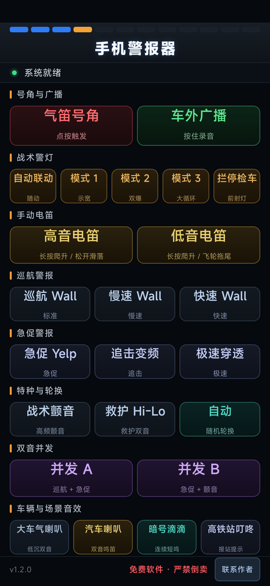
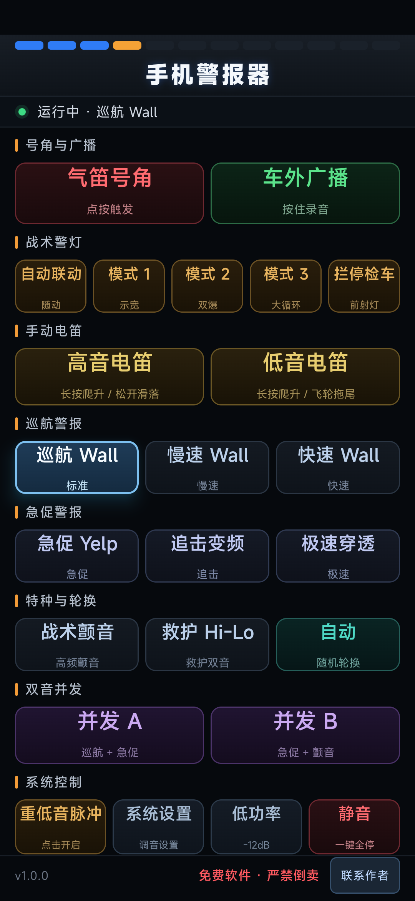
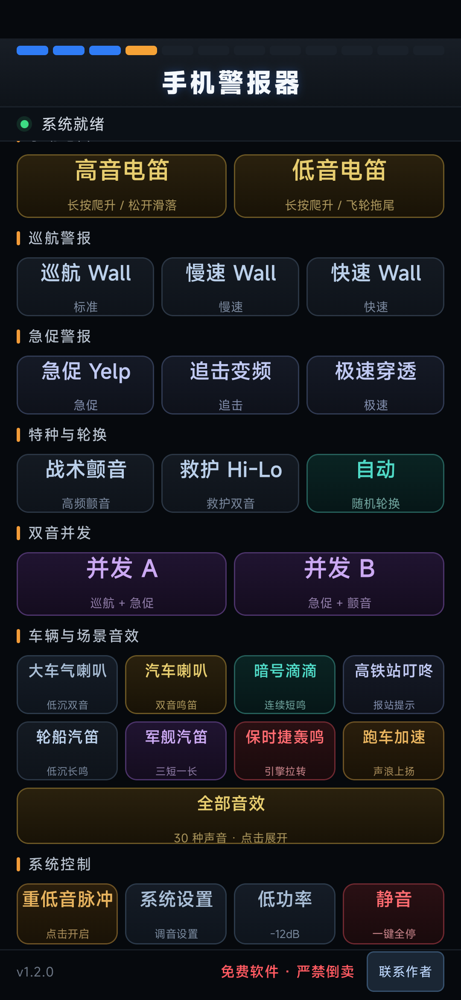
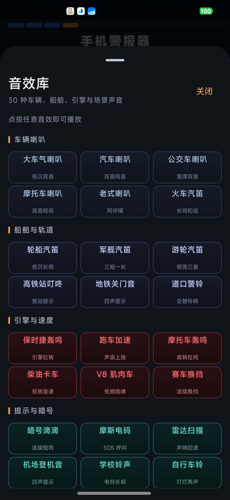

# 手机警报器 · phonebibobibo

一个把 Android 手机变成警报器 / 警灯控制面板的小工具。使用 Kotlin + Jetpack Compose 编写，所有警报音由手机实时合成，不依赖网络。

## 功能

- **气笛号角**：点按触发约 1.2 秒气笛音。
- **车外广播**：按住录音，松开后通过扬声器回放。
- **战术警灯**：自动联动、模式 1/2/3、常亮；需要设备具备相机闪光灯。
- **手动电笛**：高音 / 低音长按爬升，松开滑落或飞轮拖尾。
- **9 种警报程序**：巡航、急促、追击、极速、颤音、救护 Hi-Lo、随机轮换等，另有双音并发 A/B。
- **30 种车辆与场景音效**：车辆喇叭、船舶与轨道、引擎与速度、提示与暗号、更多场景五类；大车气喇叭、汽车喇叭、暗号滴滴、高铁站叮咚、轮船汽笛、军舰汽笛、保时捷轰鸣、跑车加速等全部保留，点按即播，全部实时合成。
- **音量与音调**：设置页滑杆可调；应用在前台时，手机音量加/减键也可直接调节警报音量，百分比和音量 Toast 会同步更新。
- **其他**：低功率模式、一键静音、重低音脉冲；活跃时保持屏幕常亮，切到后台自动停止声音和警灯。

## 构建

- JDK 17
- Android SDK 37（`compileSdk` / `targetSdk` 37，`minSdk` 26）
- 调试包：`./gradlew :app:assembleDebug`
- 发布包：`./gradlew :app:assembleRelease`（当前 release 使用调试签名，便于直接安装测试）
- 产物路径：`app/build/outputs/apk/`

## 权限

- `RECORD_AUDIO`：车外广播录音。
- `FLASHLIGHT`：战术警灯。
- 不申请网络权限，应用不联网。

## 更新说明 / Update Notes

### v1.2.0

**中文**

- 音效库扩展到 30 种，按车辆喇叭、船舶与轨道、引擎与速度、提示与暗号、更多场景五类整理；原有 8 种全部保留。
- 新增公交车/摩托/老式/火车/游轮汽笛、地铁关门音、道口警铃、柴油卡车、V8、摩托拉转、赛车换挡、摩斯电码、雷达、机场登机音、学校铃、自行车铃、冰淇淋车、倒车提示、施工警报、空袭警报、警用扩音器等。
- 主界面“车辆与场景音效”新增“全部音效”入口，点击打开可滚动的音效库；播放中可直接停止。全部声音仍为实时合成，不增加网络或音频素材依赖。
- 版本号更新为 1.2.0。

**English**

- Expanded the sound library to 30 effects in five groups: vehicle horns, ships and rail, engines and speed, signals, and extra scenes. The original eight are kept.
- Added bus, motorcycle, vintage, train and cruise horns, a metro door chime, crossing bell, diesel idle, V8, motorcycle rev, race shifts, Morse SOS, sonar, airport chime, school bell, bicycle bell, ice-cream melody, reversing beeps, construction alarm, air-raid siren, police PA and more.
- The main screen now has an "All sounds" entry that opens a scrollable library sheet, with a stop button while playing. All sounds remain real-time synthesized with no network or audio assets.
- Version bumped to 1.2.0.

### v1.1.0

**中文**

- 新增 8 种车辆与场景音效：大车气喇叭、汽车喇叭、暗号滴滴、高铁站叮咚、轮船汽笛、军舰汽笛、保时捷轰鸣、跑车加速。
- 全部音效继续使用手机实时合成，不增加网络与音频素材依赖；主界面新增“车辆与场景音效”区域。
- 版本号更新为 1.1.0。

**English**

- Added eight vehicle and scene sounds: truck air horn, car horn, recognition beeps, railway-station chime, ship horn, warship whistle, Porsche-style engine rev and acceleration sweep.
- All sounds are still synthesized in real time; no network or bundled audio assets. A new "Vehicle & Scene Sounds" section is on the main screen.
- Version bumped to 1.1.0.

### v1.0.0

**中文**

- 首个版本：完整警报音合成、战术警灯、录音回放、双音并发与设置面板。
- 修复：应用在前台时，手机音量加/减键现在直接调节警报器音量；设置页“总音量”百分比和音量 Toast 会同步更新。

**English**

- Initial release: synthesized siren programs, tactical torch patterns, push-to-talk broadcast, dual-layer programs and a settings panel.
- Fix: while the app is in the foreground, the hardware volume up/down keys now adjust the siren volume directly; the "Master volume" percentage and volume toast update in sync.

## 使用提醒

- 免费软件 · 严禁倒卖。
- 请仅在合法、合规的场景使用；不要对准他人长时间高音量播放，注意听力保护。
- 手电筒模式需要设备具备相机闪光灯；部分机型可能因相机被占用而不可用。

## 联系作者

- GitHub：https://github.com/johnson020202/phonebibobibo
