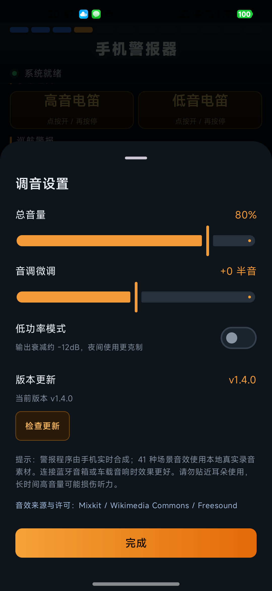

# 手机警报器 · phonebibobibo

一个把 Android 手机变成警报器 / 警灯控制面板的小工具。使用 Kotlin + Jetpack Compose 编写；警报程序由手机实时合成，41 种场景音效使用本地真实录音，不依赖网络。

## 功能

- **气笛号角**：点按触发约 1.2 秒气笛音。
- **车外广播**：按住录音，松开后通过扬声器回放。
- **战术警灯**：自动联动、模式 1/2/3、常亮；需要设备具备相机闪光灯。
- **手动电笛**：高音 / 低音均点按开启，再点停止。
- **9 种警报程序**：巡航、急促、追击、极速、颤音、救护 Hi-Lo、随机轮换等，另有双音并发 A/B。
- **47 种车辆与场景音效**：车辆喇叭、船舶与轨道、名车引擎、提示与暗号、交通提示、更多场景六类；其中 41 种使用本地真实录音，原有 8 种保留实时合成。所有卡片都是点按播放、再点停止。
- **10 台名车引擎**：保时捷 911、法拉利 V8、兰博基尼 V10、迈凯伦赛车、特斯拉电动车、宝马 M3、奔驰 AMG S63、奥迪 R8、雪佛兰 Corvette、福特 Mustang GT，均使用对应车型的真实录音。
- **交通提示音**：机场登机广播、航站楼广播、机场捷运，地铁关门/进站提示，公交到站/车厢广播，火车站台铃、高铁发车提示、列车关门提示。
- **音量与音调**：设置页滑杆可调；应用在前台时，音量加/减键每次调节 1%，按住可连续无级调节，不弹系统音量条或 Toast。
- **应用内更新**：设置页“检查更新”会读取 GitHub 最新 Release，发现新版本可下载 APK 并调起系统安装器覆盖安装。
- **其他**：低功率模式、一键静音、重低音脉冲；活跃时保持屏幕常亮，切到后台自动停止声音和警灯。

## 构建

- JDK 17
- Android SDK 37（`compileSdk` / `targetSdk` 37，`minSdk` 26）
- 调试包：`./gradlew :app:assembleDebug`
- 发布包：`./gradlew :app:assembleRelease`（当前 release 使用调试签名，便于直接安装测试）
- 产物路径：`app/build/outputs/apk/`

## 权限

- `RECORD_AUDIO`：车外广播录音。
- `FLASHLIGHT`：战术警灯。
- `INTERNET`：仅用于设置页“检查更新”和下载新版本 APK，不上传任何数据。
- `REQUEST_INSTALL_PACKAGES`：安装应用内下载的新版本；首次使用需在系统设置中允许本应用安装未知应用。

## 更新说明 / Update Notes

### v1.4.0

**中文**

- 新增“名车引擎”分类：保时捷 911、法拉利 V8、兰博基尼 V10、迈凯伦赛车、特斯拉、宝马 M3、奔驰 AMG S63、奥迪 R8、雪佛兰 Corvette、福特 Mustang GT，共 10 台车的真实录音。
- 新增“交通提示”分类：机场登机广播/航站楼广播/机场捷运，地铁关门与进站提示，公交到站与车厢广播，火车站台铃、高铁发车提示、列车关门提示。
- 音量键恢复为直接调节警报音量，步进改为 1%；按住音量键可连续无级调节，不再弹出系统音量条或 Toast。
- 设置页新增“检查更新”：读取 GitHub 最新 Release，显示新版本号，下载 APK 后调起系统安装器覆盖安装；首次使用需允许安装未知应用。
- 音效库现为 6 类 47 种，其中 41 种为本地真实录音；来源、作者和许可见 [ATTRIBUTIONS.md](ATTRIBUTIONS.md)。
- 版本号更新为 1.4.0（versionCode 5）。

**English**

- New "Supercar engines" category with real recordings of ten cars: Porsche 911, Ferrari V8, Lamborghini V10, McLaren race car, Tesla, BMW M3, Mercedes-AMG S63, Audi R8, Chevrolet Corvette and Ford Mustang GT.
- New "Transit" category: airport boarding/terminal announcements and AirTrain, metro door/arrival cues, bus stop/onboard announcements, railway station chime, high-speed departure cue and train door closing cue.
- Hardware volume keys now adjust siren volume directly in 1% steps; hold for continuous adjustment with no system volume panel or toast.
- Settings now has "Check for updates": it reads the latest GitHub Release, downloads the APK and opens the system installer. Allow installs from unknown apps on first use.
- The library now has 47 effects in six categories, 41 of them local real recordings. Sources and licenses are in [ATTRIBUTIONS.md](ATTRIBUTIONS.md).
- Version bumped to 1.4.0 (versionCode 5).

### v1.3.0

**中文**

- 统一交互：音效卡片、气笛号角和手动高/低电笛全部改为“点一下播放，再点一下停止”；不再需要长按。
- 新增 22 种真实录音素材，覆盖公交车/摩托/老式/火车/游轮汽笛、地铁关门音、道口警铃、摩托与柴油/V8/赛车引擎、SOS 摩斯、雷达、机场登机音、学校铃、自行车铃、冰淇淋车、倒车提示、施工警报、空袭警报和警用扩音器。
- 原有 8 种音效继续使用实时合成，保留原有响应与音色；新增音效使用本地 MP3，离线可用。
- 音效来源、作者和许可见 [ATTRIBUTIONS.md](ATTRIBUTIONS.md)；应用内设置页也可打开该说明。
- 版本号更新为 1.3.0。

**English**

- Unified interaction: every effect card, the air horn and both manual sirens are now "tap to play, tap again to stop"; no long-press required.
- Added 22 real recordings covering bus/motorcycle/vintage/train/cruise horns, metro door chime, crossing bell, motorcycle/diesel/V8/race engines, SOS Morse, radar, airport chime, school bell, bicycle bell, ice-cream truck, reversing beeps, construction alarm, air-raid siren and police PA.
- The original eight effects remain real-time synthesized; the new sounds are bundled local MP3s and work offline.
- Sources, authors and licenses are listed in [ATTRIBUTIONS.md](ATTRIBUTIONS.md), also reachable from Settings.
- Version bumped to 1.3.0.

### v1.2.0

**中文**

- 音效库扩展到 30 种，按车辆喇叭、船舶与轨道、引擎与速度、提示与暗号、更多场景五类整理；原有 8 种全部保留。
- 新增公交车/摩托/老式/火车/游轮汽笛、地铁关门音、道口警铃、柴油卡车、V8、摩托拉转、赛车换挡、摩斯电码、雷达、机场登机音、学校铃、自行车铃、冰淇淋车、倒车提示、施工警报、空袭警报、警用扩音器等。
- 主界面“车辆与场景音效”新增“全部音效”入口，点击打开可滚动的音效库；播放中可直接停止。全部声音仍为实时合成，不增加网络或音频素材依赖。
- 版本号更新为 1.2.0。

**English**

- Expanded the sound library to 30 effects in five groups: vehicle horns, ships and rail, engines and speed, signals, and extra scenes. The original eight are kept.
- Added bus, motorcycle, vintage, train and cruise horns, a metro door chime, crossing bell, diesel idle, V8, motorcycle rev, race shifts, Morse SOS, sonar, airport chime, school bell, bicycle bell, ice-cream melody, reversing beeps, construction alarm, air-raid siren, police PA and more.
- The main screen now has an "All sounds" entry that opens a scrollable library sheet, with a stop button while playing. All sounds remain real-time synthesized with no network or audio assets.
- Version bumped to 1.2.0.

### v1.1.0

**中文**

- 新增 8 种车辆与场景音效：大车气喇叭、汽车喇叭、暗号滴滴、高铁站叮咚、轮船汽笛、军舰汽笛、保时捷轰鸣、跑车加速。
- 全部音效继续使用手机实时合成，不增加网络与音频素材依赖；主界面新增“车辆与场景音效”区域。
- 版本号更新为 1.1.0。

**English**

- Added eight vehicle and scene sounds: truck air horn, car horn, recognition beeps, railway-station chime, ship horn, warship whistle, Porsche-style engine rev and acceleration sweep.
- All sounds are still synthesized in real time; no network or bundled audio assets. A new "Vehicle & Scene Sounds" section is on the main screen.
- Version bumped to 1.1.0.

### v1.0.0

**中文**

- 首个版本：完整警报音合成、战术警灯、录音回放、双音并发与设置面板。
- 修复：应用在前台时，手机音量加/减键现在直接调节警报器音量；设置页“总音量”百分比和音量 Toast 会同步更新。

**English**

- Initial release: synthesized siren programs, tactical torch patterns, push-to-talk broadcast, dual-layer programs and a settings panel.
- Fix: while the app is in the foreground, the hardware volume up/down keys now adjust the siren volume directly; the "Master volume" percentage and volume toast update in sync.

## 使用提醒

- 免费软件 · 严禁倒卖。
- 请仅在合法、合规的场景使用；不要对准他人长时间高音量播放，注意听力保护。
- 手电筒模式需要设备具备相机闪光灯；部分机型可能因相机被占用而不可用。

## 联系作者

- GitHub：https://github.com/johnson020202/phonebibobibo
